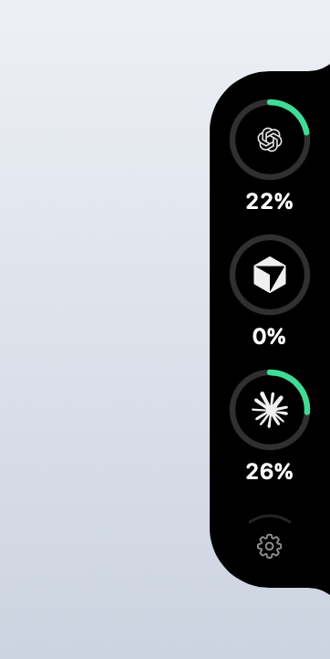

# Usage Dock



Usage Dock is a macOS overlay that shows how much of each AI coding subscription you have used. It sits on the right edge of the screen and draws one ring per provider: Codex, OpenCode Go, Command Code, Cursor, Grok, Devin, and Claude.

Usage Dock has no account and no server. A Python collector reads the logins that each provider's own tool already keeps on your Mac, and asks that provider's API for your usage. A SwiftUI app draws the answer.

> [!WARNING]
> Usage Dock is a personal tool that is being prepared for open source. It runs every day on the author's Mac, but it does not run on another machine until you edit four path constants. It has no prebuilt app yet. Read [Known limitations](#known-limitations) before you build it.

Leia este documento em [português do Brasil](README.pt-BR.md).

## Features

- The dock draws one ring per provider that has a working login, up to seven.
- The ring color follows the percent used. Green is below 40%, yellow is 40% to 69%, orange is 70% to 89%, and red is 90% or more. A red ring pulses.
- Hover a ring to open a card with each quota window of that provider. The card shows the percent used, the percent left, the time until the window resets, and the pace.
- Click a ring to pin its card. Press Esc or click outside the dock to close the card.
- The Codex card adds token statistics and a 30-day bar chart.
- A provider with no login, a cancelled or free plan, or a used-up quota leaves the dock. The collector keeps reading that provider, and the ring returns when a reading succeeds.
- The app saves the last good reading, so a restart does not blank the rings. A reading that is more than 3 minutes old fades.
- The app refreshes every 60 seconds while you use the dock, every 5 minutes when the dock is idle, and when the Mac wakes.
- Drag the dock to move it. Within 40 points of the right screen edge, the dock snaps to the edge.
- Collapse the dock to a 16-point tab. Hover or click the tab to expand the dock.

The pace compares the percent used with the share of the window that has already passed. If you used 60% of a weekly window in 3 days, you are ahead of the clock, and the card says so.

<br clear="right">

## Supported providers

| Ring | Subscription | What the ring shows | Login that the collector reads |
|---|---|---|---|
| Codex | OpenAI Codex on a ChatGPT plan | The weekly window | `~/.codex/auth.json` |
| OpenCode | OpenCode Go | The most used of the 5-hour, weekly, and monthly windows | `~/.local/share/opencode/auth.json` |
| Command | Command Code | Spend in the current billing period, as a share of spend plus remaining credits | `COMMAND_CODE_API_KEY`, then `~/.commandcode/auth.json` |
| Cursor | Cursor | The included allowance for Cursor's own models | `state.vscdb` of the Cursor editor |
| Grok | Grok CLI on SuperGrok | Credit usage in the current billing period | `~/.grok/auth.json` |
| Devin | Devin CLI | The more used of the daily and weekly quotas | `~/.local/share/devin/credentials.toml` |
| Claude | Claude Code on a claude.ai plan | The most used of the 5-hour and weekly windows | Keychain item `Claude Code-credentials` |

Each ring measures a different thing, so two rings at 50% do not mean the same. The card of each ring lists every window that the provider reports.

Usage Dock is not affiliated with any of these providers. Their APIs for usage are undocumented and can change without notice.

## Requirements

- macOS 14 or later. `Package.swift` and `Info.plist` declare macOS 14.0. The app is tested only on macOS 15.7 on an Intel Mac.
- Swift 5.10 or later, from Xcode or from the Command Line Tools. Run `xcode-select --install` to get the Command Line Tools.
- Python 3.9 or later. The collector uses only the standard library.
- A login in at least one supported tool, under the same macOS user.

## Install

Usage Dock has no release, no Homebrew formula, and no notarized build. Build it from source.

## Build from source

1. Clone the repository.

   ```sh
   git clone https://github.com/louiemota/usage-dock.git
   cd usage-dock
   ```

2. Run the collector tests. The tests use no network and no real credentials.

   ```sh
   python3 -m unittest discover -s tests
   ```

   The output ends with `Ran 47 tests` and `OK`.

3. Replace the four path constants that point to the author's machine. Write absolute paths, because the app does not expand `~`.

   | File | Constant | New value |
   |---|---|---|
   | `UsageDock/Sources/UsageDock/UsageStore.swift` | `pythonPath` | Your Python interpreter, for example `/usr/bin/python3` |
   | `UsageDock/Sources/UsageDock/UsageStore.swift` | `scriptPath` | The path of `collector.py` in your clone |
   | `UsageDock/Sources/UsageDock/UsageDockApp.swift` | `canonicalApp` | The path where you install the app |
   | `scripts/build.sh` | `LIVE` | The same install path |

4. Build, sign, and install the app.

   ```sh
   scripts/build.sh
   ```

   The script compiles a release build, assembles `UsageDock.app`, signs the app ad hoc, and copies the app to the `LIVE` path. The last line of the output is `built` followed by that path.

5. Open the app from the install path.

   ```sh
   open "$HOME/Applications/UsageDock.app"
   ```

The app has no Dock icon and no menu bar item. To quit, right-click the dock and choose **Sair**.

Steps 2 to 4 are verified on macOS 15.7 on an Intel Mac, with Swift 6.2 from the Command Line Tools and Python 3.9.6.

## Use

| Action | Result |
|---|---|
| Hover a ring | The card of that provider opens |
| Click a ring | The card stays pinned. Click the ring again to unpin the card |
| Press Esc, or click outside the dock | The open card or the settings card closes |
| Click the gear | The settings card opens |
| Right-click the dock | A menu opens with refresh, collapse, settings, reset position, and quit |
| Drag the dock | The dock moves. Release it within 40 points of the right edge to snap it there |
| Hover or click the collapsed tab | The dock expands |

To collapse the dock, use the settings card or the menu. Esc also collapses the dock when no card is open and the pointer is over the dock.

The interface is in Brazilian Portuguese. These are the labels that you see most often.

| Label | Meaning |
|---|---|
| Atualizar | Refresh now |
| Recolher, Expandir | Collapse, expand |
| Ajustes | Settings |
| Reposicionar à direita | Move the dock back to the right edge |
| Sair | Quit |
| Fora da fila | Providers that left the dock, with the reason |
| Vigiar | Put a provider back in the dock |
| usado, restante | Used, left |
| déficit, reserva | Percentage points ahead of the clock, behind the clock |
| Reseta em, resetou | Resets in, the reset time has passed |
| Leitura antiga | Stale reading |

## Configure

Usage Dock has no configuration file. The settings card shows the color legend, the time of the last reading, the last collector error, and the providers that left the dock.

The app stores the dock position and the list of providers that left the dock in the macOS user defaults, under `com.louiemota.usagedock`. The collapsed state is not stored. The dock always starts expanded.

| Environment variable | Read by | Effect |
|---|---|---|
| `USAGE_DOCK_SKIP` | `collector.py` | A comma-separated list of provider ids that the collector does not read. The ids are `codex`, `opencode`, `goat`, `cursor`, `grok`, `devin`, and `claude` |
| `USAGE_DOCK_SELECT` | The app | The id of a provider whose card opens pinned at launch |
| `USAGE_DOCK_OUTPUT` | `scripts/build.sh` | An extra path that receives a copy of the built app |
| `COMMAND_CODE_API_KEY` | `collector.py` | The Command Code API key. The collector reads this variable before `~/.commandcode/auth.json` |

To see what the app sees, run the collector by hand. The collector prints one JSON object.

```sh
USAGE_DOCK_SKIP=grok python3 collector.py
```

The example skips Grok because the Grok reading can rewrite `~/.grok/auth.json`. See [Privacy](#privacy).

## Privacy

Usage Dock sends your data only to the provider that owns each login. It has no telemetry, no analytics, and no update check. The app writes no log.

### What the collector reads

The collector reads the login files in the [Supported providers](#supported-providers) table. Two providers have extra sources.

- Codex. If the HTTP reading fails, the collector starts the Codex CLI as `codex app-server --stdio`. If the CLI also fails, the collector reads the history folder of the third-party app Codex Limits, in `~/Library/Application Support/com.github.thrr87.CodexLimits/History`.
- Claude. The collector runs `security find-generic-password -s "Claude Code-credentials" -w`. macOS can ask you to allow `security` to read that Keychain item.

### Where the collector sends requests

| Provider | Host |
|---|---|
| Codex | `chatgpt.com` |
| OpenCode | `opencode.ai` |
| Command | `api.commandcode.ai` |
| Cursor | `api2.cursor.sh` |
| Grok | `cli-chat-proxy.grok.com` and `auth.x.ai` |
| Devin | The `api_server_url` in the Devin credentials file. The default is `server.codeium.com` |
| Claude | `api.anthropic.com` |

Each request carries the token of that provider only. Some requests identify themselves the way the provider's own client does, for example with `User-Agent: claude-code/2.0`. Check the terms of each provider before you use Usage Dock.

### What Usage Dock writes

| Path | Content |
|---|---|
| `~/Library/Application Support/UsageDock/last-providers.json` | The last good readings: percentages, plan names, reset times, and error messages |
| User defaults of `com.louiemota.usagedock` | The dock position, and the providers that left the dock with the reason |
| `~/.cache/usage-dock/codex-profile.json` | A 5-minute cache of the Codex token statistics |
| `~/.grok/auth.json` | The Grok login. The collector refreshes the Grok token when it expires within 8 minutes, and writes the new token back |

The Grok login is the only login file that the collector changes. Every other login is read-only. The collector output and the files above contain no tokens, except the Grok login file itself.

### What the app listens to

The app watches mouse clicks system-wide to close an open card when you click elsewhere. The app also watches key presses system-wide, and its handler ignores every key except Esc. Apple documents that an app receives system-wide key events only when it is trusted for Accessibility. The app does not request that permission, and this behavior is not verified on a clean install.

## Known limitations

The full list, with the file and the symbol of each item, is in [docs/KNOWN-LIMITATIONS.md](docs/KNOWN-LIMITATIONS.md). These are the limitations that matter most.

- The app runs only on the author's machine until you edit four path constants. See [Build from source](#build-from-source).
- The collector is not inside the app bundle. The app calls a Python interpreter and `collector.py` by absolute path.
- The app is signed ad hoc and is not notarized. macOS blocks a copy that you download from someone else, so each user has to build the app.
- Each ring measures a different window. A ring can be green while another window of the same provider is full.
- At 100% a provider leaves the dock. The dock does not show when that quota resets.
- One slow provider can delay a whole round. The app stops the collector after 18 seconds and marks every ring as stale.
- A Codex reading that comes from the Codex Limits history can be more than 25 minutes old, and the app draws it as fresh.
- The Grok reading can rewrite `~/.grok/auth.json`.
- The dock stays above every window, including full-screen apps and shared screens.
- The interface is in Brazilian Portuguese only.
- The app supports macOS only and docks to the right edge only.

## Roadmap

No item has a date. The maintainer decides the order.

| Item | Status |
|---|---|
| Remove the machine-specific paths and ship the collector inside the app bundle | Proposed |
| Fix the readings that can mislead, limitations 1 to 7 and 13 | Proposed, waiting for triage |
| Run the collector tests in CI | Proposed |
| Windows support | Wanted. Under analysis, no code yet |
| Make the repository public | Decided. It follows the fixes and a final review |

## Contributing

Read [CONTRIBUTING.md](CONTRIBUTING.md) before you open an issue or a pull request. The project follows the [Contributor Covenant](CODE_OF_CONDUCT.md). To report a vulnerability, follow [SECURITY.md](SECURITY.md).

Coding agents start with [AGENTS.md](AGENTS.md). Language models that need a short map of the project start with [llms.txt](llms.txt). The design is in [docs/ARCHITECTURE.md](docs/ARCHITECTURE.md), and the steps to add a provider are in [docs/ADDING-A-PROVIDER.md](docs/ADDING-A-PROVIDER.md).

## Credits

Usage Dock belongs to the same visual family as [Codenotch](https://github.com/vinzdg/codenotch), by Vinz ([hivinz_ on X](https://x.com/hivinz_)). Codenotch is MIT licensed.

- `UsageDock/Sources/UsageDock/CoupledShell.swift` draws the pill that is welded to the screen edge. Its shape comes from Codenotch's `SideNotchShape`.
- `UsageDock/Sources/UsageDock/UsagePace.swift` is a port of Codenotch's `UsagePace`.
- Several behaviors follow Codenotch releases, as the code comments record: the refresh cadence, keeping the last good reading, the hover delays, and removing a provider that has no login.

The MIT notice for Codenotch is in [THIRD_PARTY_NOTICES.md](THIRD_PARTY_NOTICES.md). The provider names and logos belong to their owners.

## License

Usage Dock is released under the [MIT License](LICENSE).

The license covers the code and the documentation of this project. Third-party material in the repository keeps its own terms. [THIRD_PARTY_NOTICES.md](THIRD_PARTY_NOTICES.md) holds the MIT notice of Codenotch and the notices about the provider logos and the reference media.
