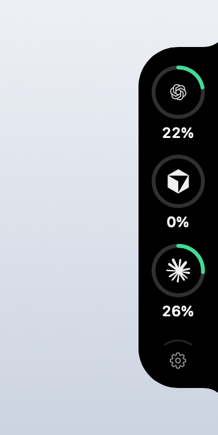

# Usage Dock



O Usage Dock é uma sobreposição para macOS que mostra quanto você já usou de cada assinatura de IA para programação. Ele fica na borda direita da tela e desenha um anel por provedor: Codex, OpenCode Go, Command Code, Cursor, Grok, Devin e Claude.

O Usage Dock não tem conta nem servidor. Um coletor em Python lê os logins que a ferramenta de cada provedor já guarda no seu Mac e pergunta o uso à API desse provedor. Um app em SwiftUI desenha a resposta.

> [!WARNING]
> O Usage Dock é uma ferramenta pessoal em preparação para virar código aberto. Ele roda todo dia no Mac do autor, mas só roda em outra máquina depois que você troca quatro constantes de caminho. Ainda não há app pronto para baixar nem licença. Leia [Limitações conhecidas](#limitações-conhecidas) antes de compilar.

Read this document in [English](README.md).

## Recursos

- O dock desenha um anel por provedor com login válido, até sete.
- A cor do anel segue o percentual usado. Verde fica abaixo de 40%, amarelo vai de 40% a 69%, laranja vai de 70% a 89% e vermelho começa em 90%. O anel vermelho pulsa.
- Passe o ponteiro sobre um anel para abrir um cartão com cada janela de cota do provedor. O cartão mostra o percentual usado, o percentual restante, o tempo até a janela zerar e o ritmo.
- Clique em um anel para fixar o cartão. Aperte Esc ou clique fora do dock para fechar o cartão.
- O cartão do Codex traz também estatísticas de tokens e um gráfico de barras de 30 dias.
- O provedor sem login, com plano cancelado ou gratuito, ou com a cota esgotada sai do dock. O coletor continua lendo esse provedor, e o anel volta quando uma leitura dá certo.
- O app guarda a última leitura boa, então reiniciar não apaga os anéis. A leitura com mais de 3 minutos fica esmaecida.
- O app atualiza a cada 60 segundos enquanto você usa o dock, a cada 5 minutos com o dock parado e quando o Mac acorda.
- Arraste o dock para mover. A menos de 40 pontos da borda direita da tela, o dock gruda na borda.
- Recolha o dock para uma aba de 16 pontos. Passe o ponteiro ou clique na aba para expandir o dock.

O ritmo compara o percentual usado com a parte da janela que já passou. Se você usou 60% de uma janela semanal em 3 dias, está adiantado em relação ao relógio, e o cartão avisa.

<br clear="right">

## Provedores suportados

| Anel | Assinatura | O que o anel mostra | Login que o coletor lê |
|---|---|---|---|
| Codex | OpenAI Codex em um plano do ChatGPT | A janela semanal | `~/.codex/auth.json` |
| OpenCode | OpenCode Go | A mais usada entre as janelas de 5 horas, semanal e mensal | `~/.local/share/opencode/auth.json` |
| Command | Command Code | O gasto do ciclo atual, como parte do gasto somado ao crédito restante | `COMMAND_CODE_API_KEY`, depois `~/.commandcode/auth.json` |
| Cursor | Cursor | A franquia incluída para os modelos do próprio Cursor | `state.vscdb` do editor Cursor |
| Grok | Grok CLI no SuperGrok | O uso de créditos no ciclo de cobrança atual | `~/.grok/auth.json` |
| Devin | Devin CLI | A mais usada entre as cotas diária e semanal | `~/.local/share/devin/credentials.toml` |
| Claude | Claude Code em um plano do claude.ai | A mais usada entre as janelas de 5 horas e semanal | Item `Claude Code-credentials` do Keychain |

Cada anel mede uma coisa diferente, então dois anéis em 50% não querem dizer o mesmo. O cartão de cada anel lista todas as janelas que o provedor informa.

O Usage Dock não tem vínculo com nenhum desses provedores. As APIs de uso deles não são documentadas e podem mudar sem aviso.

## Requisitos

- macOS 14 ou mais novo. O `Package.swift` e o `Info.plist` declaram macOS 14.0. O app só foi testado no macOS 15.7, em um Mac Intel.
- Swift 5.10 ou mais novo, do Xcode ou das Command Line Tools. Rode `xcode-select --install` para instalar as Command Line Tools.
- Python 3.9 ou mais novo. O coletor só usa a biblioteca padrão.
- Login em pelo menos uma das ferramentas suportadas, no mesmo usuário do macOS.

## Instalar

O Usage Dock não tem release, fórmula do Homebrew nem build notarizado. Compile a partir do código.

## Compilar

1. Clone o repositório.

   ```sh
   git clone https://github.com/louiemota/usage-dock.git
   cd usage-dock
   ```

2. Rode os testes do coletor. Os testes não usam rede nem credencial real.

   ```sh
   python3 -m unittest discover -s tests
   ```

   A saída termina com `Ran 47 tests` e `OK`.

3. Troque as quatro constantes de caminho que apontam para a máquina do autor. Escreva caminhos absolutos, porque o app não expande `~`.

   | Arquivo | Constante | Valor novo |
   |---|---|---|
   | `UsageDock/Sources/UsageDock/UsageStore.swift` | `pythonPath` | O seu interpretador Python, por exemplo `/usr/bin/python3` |
   | `UsageDock/Sources/UsageDock/UsageStore.swift` | `scriptPath` | O caminho do `collector.py` no seu clone |
   | `UsageDock/Sources/UsageDock/UsageDockApp.swift` | `canonicalApp` | O caminho onde você instala o app |
   | `scripts/build.sh` | `LIVE` | O mesmo caminho de instalação |

4. Compile, assine e instale o app.

   ```sh
   scripts/build.sh
   ```

   O script compila em modo release, monta o `UsageDock.app`, assina o app sem certificado e copia o app para o caminho de `LIVE`. A última linha da saída é `built` seguido desse caminho.

5. Abra o app pelo caminho de instalação.

   ```sh
   open "$HOME/Applications/UsageDock.app"
   ```

O app não tem ícone no Dock nem item na barra de menus. Para sair, clique com o botão direito no dock e escolha **Sair**.

Os passos 2 a 4 foram conferidos no macOS 15.7, em um Mac Intel, com o Swift 6.2 das Command Line Tools e o Python 3.9.6.

## Usar

| Ação | Resultado |
|---|---|
| Passar o ponteiro sobre um anel | O cartão do provedor abre |
| Clicar em um anel | O cartão fica fixo. Clique de novo no anel para soltar o cartão |
| Apertar Esc ou clicar fora do dock | O cartão aberto ou o cartão de ajustes fecha |
| Clicar na engrenagem | O cartão de ajustes abre |
| Clicar com o botão direito no dock | Abre um menu com atualizar, recolher, ajustes, reposicionar e sair |
| Arrastar o dock | O dock se move. Solte a menos de 40 pontos da borda direita para grudar o dock nela |
| Passar o ponteiro ou clicar na aba recolhida | O dock expande |

Para recolher o dock, use o cartão de ajustes ou o menu. O Esc também recolhe o dock quando não há cartão aberto e o ponteiro está sobre o dock.

A interface está em português do Brasil.

## Configurar

O Usage Dock não tem arquivo de configuração. O cartão de ajustes mostra a legenda das cores, a hora da última leitura, o último erro do coletor e os provedores que saíram do dock.

O app guarda a posição do dock e a lista de provedores fora do dock nas preferências do usuário do macOS, em `com.louiemota.usagedock`. O estado recolhido não é guardado. O dock sempre abre expandido.

| Variável de ambiente | Quem lê | Efeito |
|---|---|---|
| `USAGE_DOCK_SKIP` | `collector.py` | Lista de ids de provedor, separados por vírgula, que o coletor não lê. Os ids são `codex`, `opencode`, `goat`, `cursor`, `grok`, `devin` e `claude` |
| `USAGE_DOCK_SELECT` | O app | O id do provedor cujo cartão abre fixo na inicialização |
| `USAGE_DOCK_OUTPUT` | `scripts/build.sh` | Um caminho extra que recebe uma cópia do app compilado |
| `COMMAND_CODE_API_KEY` | `collector.py` | A chave de API do Command Code. O coletor lê essa variável antes de `~/.commandcode/auth.json` |

Para ver o que o app vê, rode o coletor à mão. O coletor imprime um objeto JSON.

```sh
USAGE_DOCK_SKIP=grok python3 collector.py
```

O exemplo pula o Grok porque a leitura do Grok pode regravar `~/.grok/auth.json`. Veja [Privacidade](#privacidade).

## Privacidade

O Usage Dock só envia os seus dados ao provedor dono de cada login. Ele não tem telemetria, análise de uso nem verificação de atualização. O app não grava log.

### O que o coletor lê

O coletor lê os arquivos de login da tabela de [Provedores suportados](#provedores-suportados). Dois provedores têm fontes extras.

- Codex. Se a leitura por HTTP falha, o coletor abre a CLI do Codex como `codex app-server --stdio`. Se a CLI também falha, o coletor lê a pasta de histórico do app de terceiros Codex Limits, em `~/Library/Application Support/com.github.thrr87.CodexLimits/History`.
- Claude. O coletor roda `security find-generic-password -s "Claude Code-credentials" -w`. O macOS pode pedir que você autorize o `security` a ler esse item do Keychain.

### Para onde o coletor envia requisições

| Provedor | Servidor |
|---|---|
| Codex | `chatgpt.com` |
| OpenCode | `opencode.ai` |
| Command | `api.commandcode.ai` |
| Cursor | `api2.cursor.sh` |
| Grok | `cli-chat-proxy.grok.com` e `auth.x.ai` |
| Devin | O `api_server_url` do arquivo de credenciais do Devin. O padrão é `server.codeium.com` |
| Claude | `api.anthropic.com` |

Cada requisição leva só o token daquele provedor. Algumas requisições se identificam como o cliente do próprio provedor, por exemplo com `User-Agent: claude-code/2.0`. Confira os termos de cada provedor antes de usar o Usage Dock.

### O que o Usage Dock grava

| Caminho | Conteúdo |
|---|---|
| `~/Library/Application Support/UsageDock/last-providers.json` | As últimas leituras boas: percentuais, nomes de plano, horas de reset e mensagens de erro |
| Preferências de `com.louiemota.usagedock` | A posição do dock e os provedores fora do dock, com o motivo |
| `~/.cache/usage-dock/codex-profile.json` | Um cache de 5 minutos das estatísticas de tokens do Codex |
| `~/.grok/auth.json` | O login do Grok. O coletor renova o token do Grok quando faltam menos de 8 minutos para ele vencer e grava o token novo no arquivo |

O login do Grok é o único arquivo de login que o coletor altera. Todos os outros logins são só lidos. A saída do coletor e os arquivos acima não contêm tokens, com exceção do próprio arquivo de login do Grok.

### O que o app escuta

O app observa os cliques do mouse no sistema inteiro para fechar o cartão aberto quando você clica em outro lugar. O app também observa as teclas no sistema inteiro, e o código ignora todas, menos o Esc. A Apple documenta que um app só recebe teclas do sistema inteiro quando tem a permissão de Acessibilidade. O app não pede essa permissão, e esse comportamento não foi conferido em uma instalação nova.

## Limitações conhecidas

A lista completa, com o arquivo e o símbolo de cada item, está em [docs/KNOWN-LIMITATIONS.md](docs/KNOWN-LIMITATIONS.md), em inglês. Estas são as limitações que mais pesam.

- O app só roda na máquina do autor até você trocar quatro constantes de caminho. Veja [Compilar](#compilar).
- O coletor não vai dentro do pacote do app. O app chama um interpretador Python e o `collector.py` por caminho absoluto.
- O app é assinado sem certificado e não é notarizado. O macOS barra a cópia baixada de outra pessoa, então cada usuário precisa compilar o app.
- Cada anel mede uma janela diferente. Um anel pode ficar verde com outra janela do mesmo provedor cheia.
- Em 100%, o provedor sai do dock. O dock não mostra quando a cota volta.
- Um provedor lento pode atrasar a rodada inteira. O app encerra o coletor depois de 18 segundos e marca todos os anéis como leitura antiga.
- A leitura do Codex que vem do histórico do Codex Limits pode ter mais de 25 minutos, e o app desenha essa leitura como nova.
- A leitura do Grok pode regravar `~/.grok/auth.json`.
- O dock fica por cima de todas as janelas, inclusive apps em tela cheia e telas compartilhadas.
- A interface só existe em português do Brasil.
- O app só roda no macOS e só gruda na borda direita.

## Próximos passos

Nenhum item tem data. O mantenedor decide a ordem.

| Item | Situação |
|---|---|
| Escolher a licença | Decisão pendente |
| Tirar os caminhos da máquina do autor e levar o coletor para dentro do pacote do app | Proposto |
| Consertar as leituras que enganam, limitações 1 a 7 e 13 | Proposto, aguardando triagem |
| Rodar os testes do coletor em CI | Proposto |
| Suporte a Windows | Desejado. Em análise, sem código |
| Tornar o repositório público | Decidido. Vem depois dos consertos e de uma revisão final |

## Contribuir

Leia [CONTRIBUTING.md](CONTRIBUTING.md) antes de abrir uma issue ou um pull request. O projeto segue o [Contributor Covenant](CODE_OF_CONDUCT.md). Para relatar uma vulnerabilidade, siga [SECURITY.md](SECURITY.md). Esses três documentos estão em inglês.

Agentes de código começam pelo [AGENTS.md](AGENTS.md). Modelos de linguagem que precisam de um mapa curto do projeto começam pelo [llms.txt](llms.txt). O desenho do sistema está em [docs/ARCHITECTURE.md](docs/ARCHITECTURE.md), e os passos para acrescentar um provedor estão em [docs/ADDING-A-PROVIDER.md](docs/ADDING-A-PROVIDER.md).

## Créditos

O Usage Dock é da mesma família visual do [Codenotch](https://github.com/vinzdg/codenotch), do Vinz ([hivinz_ no X](https://x.com/hivinz_)). O Codenotch tem licença MIT.

- `UsageDock/Sources/UsageDock/CoupledShell.swift` desenha a pílula soldada à borda da tela. A forma vem do `SideNotchShape` do Codenotch.
- `UsageDock/Sources/UsageDock/UsagePace.swift` é um porte do `UsagePace` do Codenotch.
- Vários comportamentos seguem versões do Codenotch, como registram os comentários do código: o intervalo de atualização, a permanência da última leitura boa, os atrasos do hover e a saída do provedor sem login.

O aviso MIT do Codenotch está em [THIRD_PARTY_NOTICES.md](THIRD_PARTY_NOTICES.md). Os nomes e os logos dos provedores pertencem aos seus donos.

## Licença

Pendente. O mantenedor ainda não escolheu a licença, e o repositório não tem arquivo `LICENSE`. Até a licença entrar, ninguém tem permissão para copiar, alterar ou distribuir este código. O aviso do Codenotch em [THIRD_PARTY_NOTICES.md](THIRD_PARTY_NOTICES.md) vale para os dois arquivos derivados do Codenotch.
