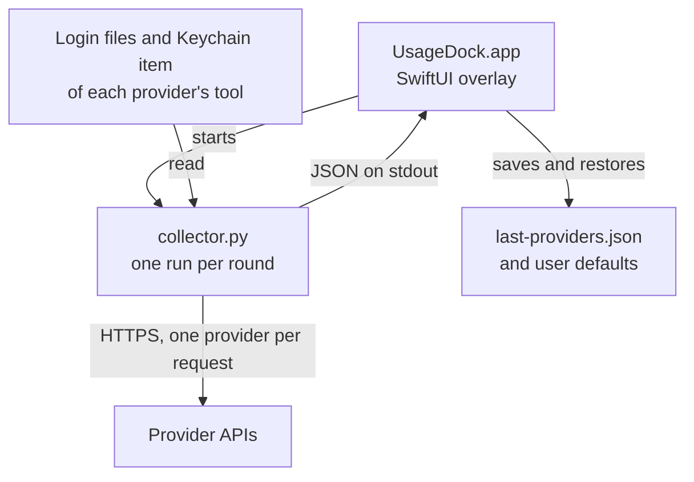

# Architecture

Usage Dock has two parts that share one contract. A Python script reads the usage of each provider and prints JSON. A SwiftUI app starts that script, decodes the JSON, and draws the dock.



The split has two effects. The tests exercise the provider logic without the app, and any other interface can draw the same JSON.

## Repository layout

```text
.
├── README.md, README.pt-BR.md   What the project is, in English and in Portuguese
├── AGENTS.md, llms.txt          Entry points for coding agents and language models
├── CONTRIBUTING.md              How to report, set up, and send a change
├── CODE_OF_CONDUCT.md           Contributor Covenant 2.1
├── SECURITY.md                  How to report a vulnerability
├── CHANGELOG.md                 Notable changes
├── THIRD_PARTY_NOTICES.md       The Codenotch MIT notice and the logo notice
├── collector.py                 The collector. One file, standard library only
├── tests/test_collector.py      47 tests for the collector. No network, no real credentials
├── scripts/build.sh             Builds, assembles, signs, and installs UsageDock.app
├── scripts/capture-dock.sh      Screenshot helper for the author's display
├── UsageDock/
│   ├── Package.swift            Swift package with one executable target
│   ├── Info.plist               Bundle identifier, version 0.1.0, build 47
│   └── Sources/UsageDock/
│       ├── UsageDockApp.swift       Entry point and app delegate
│       ├── UsageStore.swift         State, refresh schedule, collector process
│       ├── Models.swift             Layout constants and the types of the JSON contract
│       ├── OverlayController.swift  The floating panel, drag, snap, Esc, click outside
│       ├── DockView.swift           The pill, the ring column, the gear, the menu
│       ├── PopoutView.swift         The card of a provider
│       ├── SettingsModal.swift      The settings card
│       ├── CoupledShell.swift       The shape of the pill at the screen edge
│       ├── AlertPalette.swift       Color bands and theme colors
│       ├── UsagePace.swift          Pace calculation and number formats
│       ├── BrandMarks.swift         Logo views, one case per provider
│       ├── LogoAssets.swift         The Codex logo, embedded as a PNG
│       └── Resources/               One SVG logo for each of the other six providers
├── docs/                        This page, the provider guide, the known limitations, the screenshot
├── refs/                        Design specification and notes, in Portuguese
└── .github/                     Issue forms and the pull request template
```

Run `git ls-files` to see every tracked file.

## One round, step by step

A round is one run of the collector and the redraw that follows.

1. `UsageStore.pulse` runs every 15 seconds. It starts a round when the last good round is older than 60 seconds and the dock is in use, or older than 300 seconds and the dock is idle. The dock is in use while a card is open, a ring is hovered, or the settings card is open.
2. A round also starts at launch, when the Mac or its displays wake, when the user session becomes active, and when the user chooses `Atualizar` or `Vigiar`.
3. `UsageStore.runCollector` starts the Python interpreter with `collector.py`. The collector inherits the environment of the app.
4. `main` in `collector.py` submits one job per provider to a pool of 7 threads. Each job is a `_safe_` function, which never raises.
5. `main` waits for the jobs in dock order. The wait is at most 16 seconds for Codex and 10 seconds for each other provider. A job that exceeds its time yields a row with an error and `stale` set to true.
6. `main` passes each row through `apply_unwatch` and `apply_dead`, then prints one JSON object.
7. The app decodes the JSON into `CollectorPayload`. If the collector is still running after 18 seconds, the app stops it.
8. `UsageStore.apply` merges the new rows into the rows on screen. It removes and restores rings, and it keeps the last good reading of a provider whose new reading failed.
9. `UsageStore.saveArchive` writes the rows to `last-providers.json`.
10. SwiftUI redraws. `DockView` draws one `RingButton` per row, and `PopoutView` draws the card of the selected row.

If the collector prints nothing, or the JSON does not decode, the round fails. The app stores the error in `lastError`, shows it in the settings card, and fades every ring.

## The JSON contract

The collector prints one object with two keys.

| Key | Type | Meaning |
|---|---|---|
| `ts` | number | The Unix time of the round, in seconds |
| `providers` | array | One row per provider, in dock order |

### Row

`row` in `collector.py` builds the default row. `ProviderUsage` in `Models.swift` decodes it.

| Key | Type | Required by the app | Meaning |
|---|---|---|---|
| `id` | string | Yes | One of `codex`, `opencode`, `goat`, `cursor`, `grok`, `devin`, `claude` |
| `name` | string | Yes | The name in the card title |
| `ok` | boolean | Yes | True when the reading succeeded |
| `usedPercent` | number or null | No | The value of the ring, from 0 to 100 |
| `details` | array | Yes | The windows in the card. It can be empty |
| `plan` | string or null | No | The plan label in the card header |
| `error` | string or null | No | The message in the card when `ok` is false |
| `note` | string or null | No | The source of the reading. No view displays it |
| `stale` | boolean | No | True when the reading is old. The app overwrites it on every row that succeeded |
| `skipWatch` | boolean | No | True when the provider has to leave the dock |
| `profile` | object | No | The Codex token statistics. Only the Codex row has it |
| `sessions` | array | No | A list of names and statuses that the card can draw. The collector never sends it |

A row that lacks a required key makes the app reject the whole payload. The app ignores keys that it does not know.

### Detail

Each entry of `details` is one line of the card. `UsageDetail` in `Models.swift` decodes it.

| Key | Type | Meaning |
|---|---|---|
| `label` | string | The name of the window. It has to be unique in the row, because the card uses it as the identity of the line |
| `usedPercent` | number or null | The value of the bar. When it is null, the card shows `caption` and no bar |
| `resetsAt` | string or null | The reset time in ISO 8601. `iso` in `collector.py` produces it |
| `caption` | string | Extra text. Under a bar, the card shows the caption only when it contains a dollar sign |
| `windowSeconds` | number | The length of the window. The card shows the pace only when this key and `resetsAt` are present |

### Profile

The Codex row can carry `profile`, which `CodexProfileUsage` decodes. Its keys are `lifetimeTokens`, `peakDailyTokens`, `longestChatSeconds`, `currentStreakDays`, `longestStreakDays`, `todayTokens`, `thirtyDayTokens`, and `daily`. `daily` is required and holds 30 integers, one per day, oldest first.

### Example

The numbers in this example are invented.

```json
{
  "ts": 1794700000.0,
  "providers": [
    {
      "id": "claude",
      "name": "Claude",
      "ok": true,
      "usedPercent": 41.0,
      "details": [
        {"label": "5 horas", "usedPercent": 41.0, "resetsAt": "2026-11-14T18:00:00-03:00", "windowSeconds": 18000},
        {"label": "Semanal", "usedPercent": 12.0, "resetsAt": "2026-11-19T09:00:00-03:00", "windowSeconds": 604800}
      ],
      "note": "via Claude Code",
      "plan": "Max 5x",
      "error": null,
      "stale": false,
      "skipWatch": false
    },
    {
      "id": "cursor",
      "name": "Cursor",
      "ok": false,
      "usedPercent": null,
      "details": [],
      "note": null,
      "plan": null,
      "error": "Cursor deslogado",
      "stale": false,
      "skipWatch": true
    }
  ]
}
```

## How the collector reads a provider

Most providers follow one pattern with three functions.

- `collect_<provider>` reads the login, calls the API, and returns raw data. On failure it returns `ok` false with an `error`.
- `fill_<provider>_row` turns the raw data into a row. It uses no network, so the tests call it with sample payloads.
- `_safe_<provider>` calls the other two and turns any exception into a row with an error.

OpenCode, Command, Devin, and Claude follow the pattern. Codex, Cursor, and Grok build the row inside the `collect_` function.

| Id | Entry point | Request | Value of the ring |
|---|---|---|---|
| `codex` | `collect_codex` | `GET chatgpt.com/backend-api/wham/usage` and `wham/profiles/me` | The weekly window, or the most used window when no weekly window exists |
| `opencode` | `collect_opencode`, `fill_opencode_row` | `GET opencode.ai/zen/go/v1/usage` | The most used of `rolling`, `weekly`, and `monthly` |
| `goat` | `collect_commandcode`, `fill_command_row` | `GET api.commandcode.ai/alpha/whoami`, `/alpha/billing/credits`, `/alpha/billing/subscriptions`, and `/alpha/usage/summary` | Spend divided by spend plus remaining credits |
| `cursor` | `collect_cursor` | `POST api2.cursor.sh/aiserver.v1.DashboardService/GetCurrentPeriodUsage` and `GetAggregatedUsageEvents` | The allowance for Cursor's own models, or the third-party percentage when the first is missing |
| `grok` | `collect_grok` | `GET cli-chat-proxy.grok.com/v1/billing?format=credits`, and `POST auth.x.ai/oauth2/token` to refresh the token | `creditUsagePercent` |
| `devin` | `collect_devin`, `fill_devin_row` | `POST <api_server_url>/exa.seat_management_pb.SeatManagementService/GetUserStatus` | The more used of the daily and weekly quotas |
| `claude` | `collect_claude`, `fill_claude_row` | `GET api.anthropic.com/api/oauth/usage` | The most used of `five_hour`, `seven_day`, `seven_day_opus`, and `seven_day_sonnet` |

Codex has three sources, and `collect_codex` tries them in order.

1. `collect_codex_http` calls the ChatGPT backend with the token in `~/.codex/auth.json`.
2. `collect_codex_live` starts the Codex CLI as `codex app-server --stdio` and asks for the rate limits.
3. `collect_codex_history` reads the newest history file of the third-party app Codex Limits.

`_codex_fetch_profile` caches the Codex token statistics for 5 minutes in `~/.cache/usage-dock/codex-profile.json`. After an HTTP 429 response, it waits 60 seconds before the next request.

## When a ring leaves the dock

A provider leaves the dock when its row has `ok` false and one of two conditions holds. Either `skipWatch` is true, or the error text contains one of the substrings in `ProviderUsage.shouldPark`.

The collector sets `skipWatch` in three places.

- Most `collect_` functions set it when the login is missing, or when the provider answers 401 or 403. Claude is the exception. A Claude token that expired or was refused keeps the ring, and the ring fades.
- `apply_unwatch` sets it when the error text contains one of the substrings in `UNWATCH_HINTS`.
- `apply_dead` replaces a row that succeeded with an error row when the plan is cancelled, the plan label is `Free` or `Hobby`, or `usedPercent` is 99.9 or more.

The app stores the ids of those providers in `skippedIDs` and saves them in the user defaults. The collector keeps reading them. When a row of one of those providers comes back with `ok` true, `UsageStore.apply` puts the ring back.

A time limit and an HTTP 5xx response do not remove a ring. The ring stays, and it fades.

## The window and the pointer

`OverlayController` owns one borderless, non-activating `NSPanel` at the status bar level. The panel joins every Space and stays over full-screen apps.

- **Size.** The panel is always as large as the expanded pill plus the widest card, 318 points wide. A code comment records the reason: a smaller window clips the animation that expands and collapses the pill.
- **Clicks.** `MovableRootView.hitTest` accepts the pointer only over the pill and over an open card. Every other click passes through to the window below.
- **Position.** `anchorMaxX` and `anchorMaxY` hold the top right corner of the pill. `place` computes the panel frame from that anchor.
- **Drag.** Local event monitors start a drag after the pointer moves 6 points with the button down. Within 40 points of the right edge of the visible screen, the dock snaps to the edge and draws the welded shape `CoupledShell`. Away from the edge, it draws a capsule with a shadow.
- **Dismissal.** One global monitor closes cards on a click outside the panel. Another global monitor handles Esc. `handleEscape` closes the settings card, then the provider card, and collapses the dock only when the pointer is over the panel.

## State and persistence

| State | Where it lives | Survives a restart |
|---|---|---|
| Rows on screen, selection, hover, collapsed | `UsageStore`, in memory | No. The dock starts expanded with no card open |
| Last good rows | `~/Library/Application Support/UsageDock/last-providers.json` | Yes. Rows older than 180 seconds load as stale |
| Providers that left the dock, with reasons | User defaults, keys `usageDock.skippedIDs` and `usageDock.skippedReasons` | Yes |
| Dock position | User defaults, keys `usageDock.anchorMaxX`, `usageDock.anchorMaxY`, and `usageDock.coupledTrailing` | Yes |
| Codex token statistics | `~/.cache/usage-dock/codex-profile.json` | Yes, for 5 minutes |

## Timing

| Constant | Value | Where |
|---|---|---|
| Pulse | 15 s | `UsageStore.pulseEvery` |
| Refresh while the dock is in use | 60 s | `UsageStore.busyInterval` |
| Refresh while the dock is idle | 300 s | `UsageStore.idleInterval` |
| Age at which a ring fades | 180 s | `UsageStore.staleAfter` |
| Collector stopped by the app | 18 s | `UsageStore.runCollector` |
| Wait for Codex | 16 s | `CODEX_FUTURE_TIMEOUT` |
| Wait for each other provider | 10 s | `PROVIDER_FUTURE_TIMEOUT` |
| Delay before a card opens on hover | 90 ms | `UsageStore.hoverGraceOpen` |
| Delay before a card closes | 180 ms | `UsageStore.hoverGraceClose` |
| Grok token refreshed when it expires within | 8 min | `grok_access_token` |

## Launch

`AppDelegate.applicationDidFinishLaunching` runs three steps before it shows the dock.

1. `handOffToCanonicalIfNeeded` compares the running copy with the copy at `canonicalApp`. If the copy at `canonicalApp` has a higher build number, the running copy opens it and quits.
2. `terminateOtherInstances` quits every other process with the bundle identifier `com.louiemota.usagedock`.
3. The app sets the accessory activation policy, so it has no Dock icon and no menu bar.

## Build

`UsageDock/Package.swift` declares one executable target and excludes `Resources` from the package. `scripts/build.sh` copies the SVG logos into `Contents/Resources` of the app bundle, and `BundledSVGMark` loads them from `Bundle.main`. By the code, a binary that runs outside the bundle finds no SVG and draws a dashed circle in place of each logo.

The build script signs the bundle ad hoc. It tries a universal build first and falls back to the architecture of the host. See [KNOWN-LIMITATIONS.md](KNOWN-LIMITATIONS.md) for the limits of the build.
